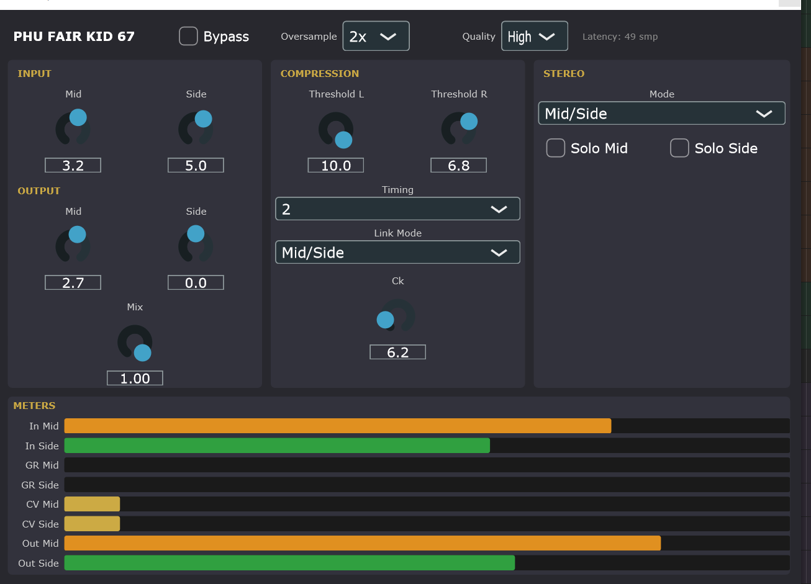

# PHU FAIR KID 67

A free, open-source stereo variable-mu tube compressor plug-in modelled after the circuit topology of the classic **Fairchild 670** levelling amplifier.  
Available as **VST3** (Windows, macOS, Linux) and **AU** (macOS).



---

## Documentation

| Document | Audience | Contents |
|---|---|---|
| [**User Guide**](docs/USER_GUIDE.md) | End users | Installation, parameters & controls, how it works, further reading |
| [**Building & Contributing**](docs/BUILDING.md) | Developers | Build prerequisites, clone & build instructions, running tests, project structure, CI & release process (tag push or manual dispatch), contributing guidelines, license |
| [**Tools & Scripts**](docs/TOOLS_AND_SCRIPTS.md) | Developers | `phu_calibrate` offline calibration tool, `plot_timing.py`, `plot_transfer.py`, `install-linux-deps.sh` |

Additional reference documents in `docs/`:

- [Offline Calibration Workflow](docs/calibration-workflow.md) — step-by-step guide for timing and transfer measurements
- [Fairchild 670 Spec Traceability](docs/fairchild670-spec-traceability.md) — mapping from hardware specs to DSP parameters
- [Performance Analysis](docs/performance-analysis.md) — CPU and latency benchmarks

---

## Quick Start

**Install the plug-in** — download the latest release from the [Releases page](../../releases) and follow the platform instructions in the [User Guide](docs/USER_GUIDE.md#2-system-requirements--installation).

**Build from source** — see [Building & Contributing](docs/BUILDING.md). The short version:

```bash
git clone https://github.com/huberp/phu-fair-kid-67.git   # JUCE and phu-audio-lib are fetched by CMake
cd phu-fair-kid-67
cmake --preset linux-x64-vst3-release          # or the preset for your platform
cmake --build --preset linux-x64-vst3-release-build
```

**Run the tests:**

```bash
cmake --preset dsp
cmake --build --preset dsp-build
ctest --preset dsp-test
```

---

## License

MIT — see [LICENSE](LICENSE) for the full text.  
Third-party: **JUCE** ([dual-licensed](https://github.com/juce-framework/JUCE/blob/master/LICENSE.md)), **phu-audio-lib** (see `phu-audio-lib/LICENSE`).